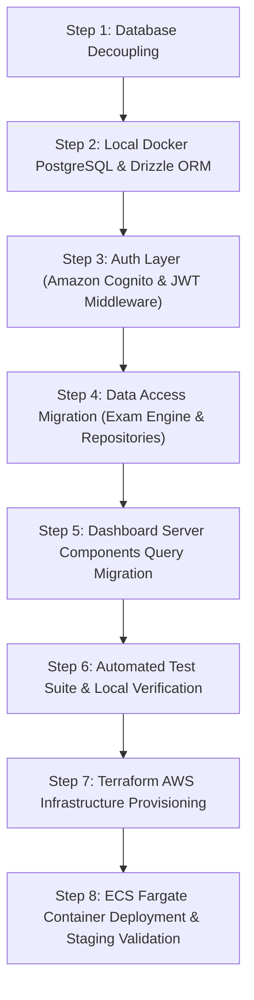

# SHARKVISION — AWS-Native Architecture & Dependency Assessment
**Target Infrastructure:** AWS (ECS Fargate + Aurora/RDS PostgreSQL + Amazon Cognito)  
**Author:** Principal AWS Solutions Architect, Senior Next.js Engineer & PostgreSQL Database Architect  
**Assessment Date:** 2026-11-12  
**Document Status:** Complete (Read-Only Codebase Audit)  

---

## 1. Executive Summary

This assessment details the complete architectural and operational transformation required to migrate **SHARKVISION** from its current Supabase BaaS (Backend-as-a-Service) model to an enterprise AWS-native deployment. 

The application is structured as a **modular monolith** with clean boundary separations:
- **Presentation & Routing:** Next.js 16 (App Router with Server Actions & Route Handlers)
- **Domain Engines:** Pure TypeScript calculators for behavioral analytics, simulation, and exam scoring (zero external runtime dependencies)
- **Data Access & Identity:** Currently coupled to Supabase Auth (`@supabase/ssr`) and the Supabase PostgREST client library (`@supabase/supabase-js`)

The proposed target architecture maintains the modular monolith design, eliminating Supabase lock-in while leveraging AWS managed services: **Next.js on AWS ECS Fargate**, **Amazon RDS PostgreSQL** (or Aurora Serverless v2), **Amazon Cognito User Pools** (for authentication), **Application Load Balancer (ALB)**, **AWS Secrets Manager**, and **Amazon CloudWatch**, fully provisioned via **Terraform**.

---

## 2. Current Architecture vs. Proposed Target Architecture

```
CURRENT ARCHITECTURE (Supabase BaaS)
┌─────────────────────────────────────────────────────────────┐
│ Next.js App Router (Local / Vercel)                         │
│  - Middleware: @supabase/ssr session management             │
│  - Server Actions / Route Handlers: supabase.from(...)      │
└──────────────────────────────┬──────────────────────────────┘
                               │ HTTPS / PostgREST
                               ▼
┌─────────────────────────────────────────────────────────────┐
│ Supabase Managed Platform                                   │
│  - Supabase Auth (GoTrue) -> auth.users                     │
│  - PostgreSQL Database (with auth.uid() RLS policies)       │
│  - PostgREST Data API Layer                                 │
└─────────────────────────────────────────────────────────────┘
```

```
PROPOSED TARGET ARCHITECTURE (AWS Native & Local Docker)
┌──────────────────────────────────────────────────────────────────────────┐
│ Client (Browser)                                                         │
└────────────────────────────────────┬─────────────────────────────────────┘
                                     │ HTTPS
                                     ▼
┌──────────────────────────────────────────────────────────────────────────┐
│ Application Load Balancer (ALB) + ACM TLS Certificate                    │
└────────────────────────────────────┬─────────────────────────────────────┘
                                     │ HTTP (Private Subnet)
                                     ▼
┌──────────────────────────────────────────────────────────────────────────┐
│ AWS ECS Fargate (Containerized Next.js 16 Application)                   │
│  - Auth Layer: AWS Amplify / jose / aws-jwt-verify (Cognito User Pool)   │
│  - DB Data Access Layer: Native PostgreSQL (Drizzle ORM / Kysely / pg)    │
│  - Session Handling: Encrypted HTTP-only cookies / JWT verification     │
│  - Observability: Structured JSON logs streaming to CloudWatch Logs     │
└───────────────────┬──────────────────────────────────┬───────────────────┘
                    │ Connection Pooling               │ OAuth2 / OIDC
                    ▼                                  ▼
┌───────────────────────────────────────┐ ┌────────────────────────────────┐
│ Amazon RDS PostgreSQL (Multi-AZ)      │ │ Amazon Cognito User Pool       │
│  - Standard PostgreSQL 16             │ │  - App Client & User Directory │
│  - Schema: public.profiles, etc.      │ │  - Custom attributes: userRole │
│  - Enforced RBAC at Service/DB Layer  │ │  - SRP / Auth flow tokens      │
└───────────────────────────────────────┘ └────────────────────────────────┘
```

---

## 3. Supabase Dependency Inventory

### 3.1 Package Dependencies
Currently declared in `package.json`:
- `@supabase/ssr`: `^0.12.7`
- `@supabase/supabase-js`: `^2.119.0`

### 3.2 Codebase Import Footprint
The codebase contains 29 files importing or referencing Supabase across five distinct categories:

| Category | File Paths | Usage Description |
| :--- | :--- | :--- |
| **Client / Context Initialization** | `src/lib/supabase/client.ts`<br>`src/lib/supabase/server.ts`<br>`src/lib/supabase/middleware.ts`<br>`src/lib/supabase/admin.ts` | Factory functions initializing browser, cookie-aware server, and service-role clients. |
| **Authentication & Session** | `src/middleware.ts`<br>`src/lib/auth/actions.ts`<br>`src/lib/auth/session.ts` | Route protection, `signInWithPassword`, `signUp`, `resetPasswordForEmail`, `updateUser`, and session retrieval. |
| **Exam Engine & Management** | `src/lib/exam/engine.ts`<br>`src/lib/exam/management.ts`<br>`src/app/api/exam/events/route.ts`<br>`src/app/api/exam/response/route.ts`<br>`src/app/api/exam/submit/route.ts` | Starting/resuming exams, question/exam creation, appending event telemetry, upserting responses, transactional grading. |
| **Analytics & Intelligence** | `src/features/analytics/repositories/analytics-repository.ts`<br>`src/features/analytics/services/analytics-service.ts`<br>`src/features/intelligence/actions/revision-actions.ts`<br>`src/app/api/analytics/attempt/[attemptId]/route.ts` | Fetching historical responses, reading/writing analytics snapshots, persisting revision plans and tasks. |
| **Server Component Pages** | `src/app/(dashboard)/admin/...`<br>`src/app/(dashboard)/teacher/...`<br>`src/app/(dashboard)/student/...`<br>`src/app/(dashboard)/parent/...` | Direct data querying in Server Components to feed dashboard views. |

### 3.3 Storage Usage
- **Result:** **Zero (0) Supabase Storage dependencies**.
- Neither `supabase.storage` nor storage bucket policies exist in the codebase. All image references (e.g. `image_url` on questions, `avatar_url` on profiles) are stored as text URLs, making migration to Amazon S3 simple if media uploads are added in the future.

---

## 4. PostgreSQL Migration & Compatibility Review

The database migration suite in `supabase/migrations/` consists of five sequential SQL files:
1. `20261112000001_initial_schema.sql` (10 tables, enums, triggers, RLS)
2. `20261112000002_bootstrap_admin.sql` (Super admin promotion)
3. `20261112000003_examination_engine.sql` (Exam engine tables, attempts, events)
4. `20261112000004_analytics_engine.sql` (Benchmarks, analytics snapshots)
5. `20261112000005_advanced_intelligence.sql` (Revision plans, tasks, digests)

### 4.1 Compatibility with Standard PostgreSQL (RDS / Local Docker)
- **Enums & Types:** Standard PostgreSQL `CREATE TYPE ... AS ENUM` used throughout. 100% compatible.
- **UUID Generation:** Uses standard `gen_random_uuid()`. 100% compatible with PostgreSQL 13+.
- **JSONB Capabilities:** Deep JSONB usage in `snapshot_options`, `payload`, and `attempt_analytics_snapshots`. Standard PostgreSQL feature, 100% compatible.
- **Indexes & Constraints:** Standard B-tree indices and foreign keys with cascade behaviors. 100% compatible.

### 4.2 Incompatibilities Requiring Adaptation
1. **Foreign Key to `auth.users`:**
   - In `20261112000001_initial_schema.sql`:
     ```sql
     CREATE TABLE public.profiles (
       id UUID PRIMARY KEY REFERENCES auth.users(id) ON DELETE CASCADE,
       ...
     );
     ```
   - In standard PostgreSQL / Cognito, `auth.users` does not exist. `profiles.id` must be defined as `UUID PRIMARY KEY DEFAULT gen_random_uuid()` or mapped directly to Cognito's `sub` (UUID format).
2. **Supabase Auth Hook Trigger:**
   - `CREATE TRIGGER on_auth_user_created AFTER INSERT ON auth.users ...` must be replaced by an application-level profile creation routine upon Cognito sign-up or via an AWS Cognito Post-Confirmation Lambda trigger.
3. **Supabase In-Database Helper Functions:**
   - Functions utilizing `auth.uid()` and `auth.jwt()` cannot function without Supabase session headers injected by PostgREST.

---

## 5. Amazon Cognito Migration Requirements

### 5.1 Architecture & Role Mapping
To preserve the four user roles (`SUPER_ADMIN`, `TEACHER`, `PARENT`, `STUDENT`) without data loss:
- **User Pool Configuration:**
  - Standard attributes: `email` (Username alias), `name`, `phone_number`.
  - Custom attribute: `custom:role` (values: `SUPER_ADMIN`, `TEACHER`, `PARENT`, `STUDENT`).
  - Alternative: Cognito User Groups (`SuperAdminGroup`, `TeacherGroup`, etc.) mapped directly in ID tokens.
- **Authentication Flows:**
  - Replace `supabase.auth.signInWithPassword()` with Cognito InitiateAuth (USER_PASSWORD_AUTH or SRP).
  - Replace `supabase.auth.signUp()` with Cognito SignUp.
  - Verification emails handled natively through Amazon SES linked to Cognito.
- **Token Handling in Next.js:**
  - Tokens (`IdToken`, `AccessToken`, `RefreshToken`) stored in encrypted, HTTP-only, `SameSite=Strict` cookies.
  - Server validation performed using `aws-jwt-verify` or standard `jose` verifying the Cognito JWKS (JSON Web Key Set).

---

## 6. Row-Level Security (RLS) & Authorization Redesign

### 6.1 Why Supabase RLS Cannot Be Kept "As-Is" on RDS
Supabase RLS depends on PostgreSQL setting session variables per HTTP request (`SET LOCAL request.jwt.claim.sub = ...`) mediated by the PostgREST proxy. When connecting via a Node.js connection pool (e.g. pg pool, Drizzle, Prisma, or Kysely):
- Connections are reused across multiple requests and different users.
- If using `SET LOCAL`, any leaked connection could result in catastrophic authorization leakage between tenants.

### 6.2 Recommended Strategy: Application-Enforced Service Layer Authorization
The Sharkvision codebase **already has explicit application-level checks** in place:
1. `requireAuth()` and `requireRole(["TEACHER", "SUPER_ADMIN"])` in `src/lib/auth/session.ts`.
2. Explicit ownership filters:
   - `examination_attempts`: queries already check `.eq("student_id", user.id)`.
   - `attempt_events`: verified against `attempt.student_id === user.id`.
   - `attempt_responses`: deadline and ownership checked before upsert.
   - `parent_student_links`: explicit join verifying `psl.is_verified = TRUE`.

**Migration Action:**
Maintain defense-in-depth by enforcing tenant filtering in repository/service layer queries, while running database migrations on RDS with standard table permissions. For organizations requiring database-level RLS, PostgreSQL RLS can be configured with transaction-scoped `SET LOCAL app.current_user_id = '<user_uuid>'`.

---

## 7. Database Access Layer Replacement

Currently, application components make PostgREST query calls:
```typescript
const { data, error } = await supabase.from("examinations").select("*").eq("id", id);
```

### 7.1 Recommended Replacement: Lightweight Query Builder (Kysely or Drizzle ORM)
To maintain the **lightweight modular monolith** requirement without heavyweight ORM bloat (such as Prisma's binary engine):
- **Recommendation:** **Drizzle ORM** with `pg` (node-postgres) driver.
- **Why Drizzle:**
  - TypeScript-native with zero binary dependencies.
  - Exceptional cold-start performance (< 5ms) on ECS Fargate / serverless containers.
  - Query syntax is clean, type-safe, and maps 1:1 to existing relational queries.
  - Native connection pooling via `pg.Pool`.

---

## 8. Potential Security & Operational Regressions

| Risk Area | Threat / Regression Description | Mitigation |
| :--- | :--- | :--- |
| **Session Invalidation** | Supabase handled token refresh and revocation automatically. Cognito refresh tokens require explicit rotation or refresh routines. | Implement automatic refresh token rotation in Next.js middleware using Cognito token endpoints. |
| **Direct Object Reference (IDOR)** | Removing database-enforced `auth.uid()` policies shifts the burden of authorization strictly to application code. | Maintain the existing centralized `requireRole()` and repository filters; add automated integration test suites asserting cross-tenant access rejection. |
| **Connection Exhaustion** | Supabase provided Supavisor connection pooling. Direct connections from ECS tasks to RDS can exhaust PostgreSQL max connections during mock exam traffic spikes. | Deploy **AWS RDS Proxy** between ECS Fargate tasks and RDS PostgreSQL to handle connection pooling seamlessly. |
| **Registration Role Escalation** | Supabase trigger forced all public signups to `STUDENT`. | Enforce in the registration action and Cognito Pre-Sign-Up / Post-Confirmation Lambda trigger that `custom:role` is immutable and defaults strictly to `STUDENT`. |

---

## 9. Preservation of Existing Test Suites

- **Unit & Calculator Tests (42/42 Tests):**
  - `tests/unit/analytics-calculators.test.ts` (100% pure TS math — preserved without modification)
  - `tests/unit/timing-accumulator.test.ts` (100% pure timing logic — preserved without modification)
  - `tests/unit/grading.test.ts` (100% pure grading logic — preserved without modification)
  - `tests/unit/exam-validation.test.ts` (Zod schemas — preserved without modification)
  - `tests/unit/validation.test.ts` (Zod schemas — preserved without modification)
  - `tests/unit/advanced-intelligence.test.ts` (pure algorithms — preserved without modification)
- **Database RLS Audit Tests:**
  - `tests/unit/database-rls.test.ts` currently parses `20261112000001_initial_schema.sql` looking for Supabase RLS strings. This test will be updated to audit the new standard PostgreSQL schema and authorization guards.

---

## 10. Local Development Strategy (Docker PostgreSQL)

The application will run locally with zero cloud dependencies:
1. **Local PostgreSQL:** A lightweight `docker-compose.yml` defining PostgreSQL 16.
2. **Local Auth Emulation / Cognito:**
   - In local development, an environment variable `AUTH_PROVIDER=local` or mock session provider can be used, or developers can connect directly to a shared Cognito Dev User Pool.
3. **Database Seed Script:** A single `npm run db:seed` script populating test accounts for each of the 4 roles.

---

## 11. Implementation Effort by Module

| Module | Scope of Work | Complexity | Estimated Effort |
| :--- | :--- | :---: | :---: |
| **1. Database Layer** | Decouple `auth.users` FK, convert DDL for RDS/local PG, configure Drizzle ORM schema & client. | Medium | 1.5 Days |
| **2. Auth & Sessions** | Implement Cognito authentication service (Login, Register, Forgot Password), replace middleware session handler with JWT verification. | High | 2.0 Days |
| **3. Exam Engine Data Access** | Update `startOrResumeExam`, `finalizeAttempt`, and exam API endpoints from Supabase client to Drizzle/pg queries. | Medium | 1.5 Days |
| **4. Intelligence & Dashboards** | Update server components and analytics repositories to query database via Drizzle/pg. | Medium | 1.5 Days |
| **5. Local Docker Setup** | Author `docker-compose.yml` for PostgreSQL 16 and database migration runners. | Low | 0.5 Days |
| **6. Terraform & AWS Infra** | Author Terraform modules: VPC (multi-AZ), ECS Fargate, RDS PostgreSQL + RDS Proxy, ALB, Cognito User Pool, Secrets Manager. | High | 2.5 Days |
| **7. CI/CD & ECR Deployment** | Update `.github/workflows` to build Docker container, push to ECR, and trigger ECS task deployment. | Medium | 1.0 Day |
| **Total** | Full end-to-end migration, verification, and automated testing. | | **10 Days** |

---

## 12. Migration Dependency Map



---

## 13. Architectural Assumptions Requiring Confirmation

1. **Cognito Hosted UI vs. Custom UI:** Assumption is that Sharkvision will **retain its existing custom branded Next.js login/registration forms** via the Cognito API rather than redirecting to the AWS Cognito Hosted UI.
2. **Transactional Email Delivery:** Assumption is that Amazon SES will be provisioned in the same AWS region for password reset and email verification emails.
3. **Single Region Deployment:** Initial production target is a single AWS region with Multi-AZ redundancy (e.g., `ap-south-1` Mumbai for Indian low latency).
